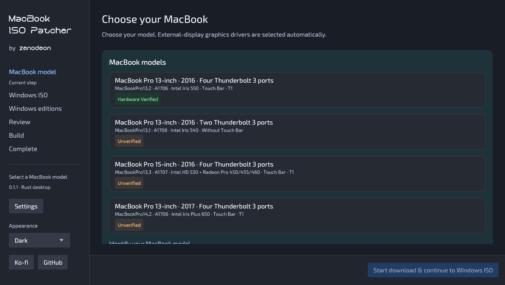
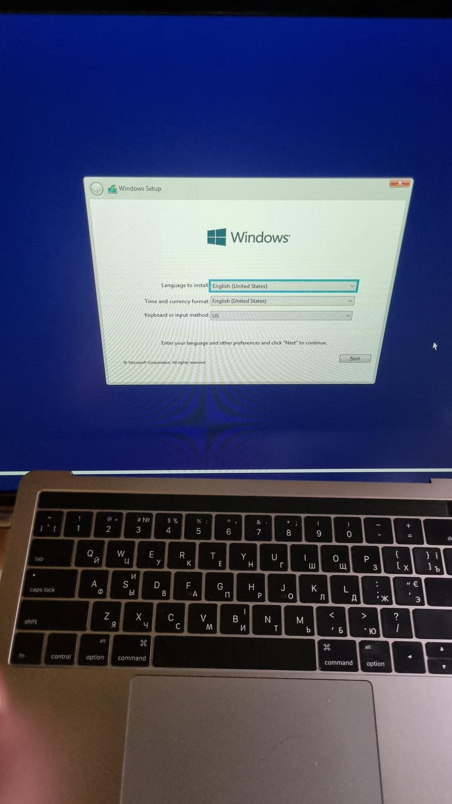
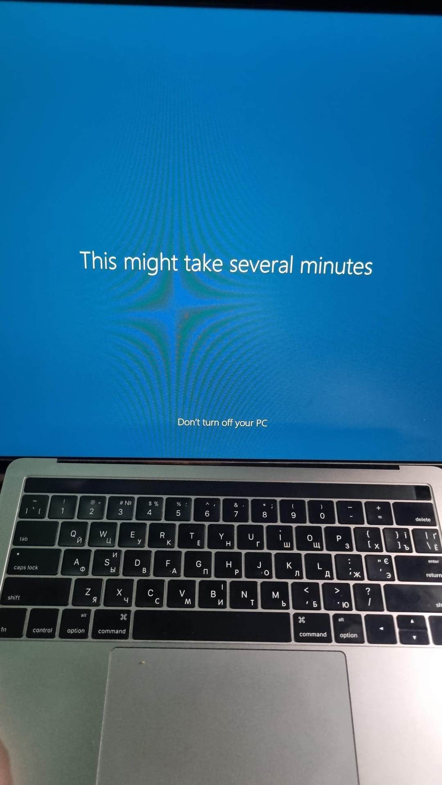

# MacBook ISO Patcher

Patch your Windows ISO to boot Windows Setup on a headless MacBook and send
the display output to an external screen, so you can continue installation
without an internal display.



## Tested on a headless MacBook

Photos from the working Windows 10 setup on a headless MacBook Pro 13-inch
A1706 (2016), using an external screen. This is the setup the patcher's 2016
A1706 recipe is based on.

| Windows Setup on the external screen | Windows finishing setup |
| --- | --- |
|  |  |

## Supported Macs

The goal is to support Intel-based Macs first, then explore support for
Apple silicon (M-series) Macs. The only hardware-verified model so
far is a headless MacBook Pro 13-inch A1706 (2016). Support and testing for
other models are still in progress.

| Mac | Identifier | Graphics | Status |
| --- | --- | --- | --- |
| MacBook Pro 13-inch 2015 | Pending | Model-dependent | Coming soon |
| MacBook Pro 15-inch 2015 | Pending | Model-dependent | Coming soon |
| MacBook Pro 13-inch 2016 · A1708 · No Touch Bar | `MacBookPro13,1` | Iris 540 | Ready for testing · Unverified |
| MacBook Pro 13-inch 2016 · A1706 · Touch Bar | `MacBookPro13,2` | Iris 550 | Hardware Verified (headless) |
| MacBook Pro 15-inch 2016 · A1707 · Touch Bar | `MacBookPro13,3` | Intel HD 530 + Radeon Pro | Ready for testing · Unverified |
| MacBook Pro 13-inch 2017 · A1706 · Touch Bar | `MacBookPro14,2` | Iris Plus 650 | Ready for testing · Unverified |
| MacBook Pro 13-inch 2017 · No Touch Bar | Pending | Model-dependent | Coming soon |
| MacBook Pro 15-inch 2017 | Pending | Model-dependent | Coming soon |
| iMac 21.5-inch 2017 · Core i5 | `iMac18,1` | Iris Plus 640 | Ready for testing · Unverified |
| MacBook Pro 2018-2020 · Intel | Pending | Model-dependent | Coming soon |
| MacBook Air · Intel | Pending | Model-dependent | Coming soon |
| MacBook 12-inch · Intel | Pending | Model-dependent | Coming soon |
| Other Intel Macs · iMac, Mac mini and Mac Pro | Pending | Model-dependent | Planned |

The verified result comes from the working 2016 A1706 Windows 10 Pro recipe.
Newly generated ISOs still need testing on the target Mac. Coming-soon and planned
models are a roadmap.

Select the year and identifier carefully: A1706 includes both 2016 and 2017 models.
The two A1706 profiles have separate external-display Setup recipes.

For iMac18,1, choose Built-in screen or External screen on its model card.
This selects the Windows Setup screen; desktop display settings can be changed
in Windows afterward. Use a wired USB keyboard and mouse for initial testing.

## Files you need

- An original Microsoft Windows 10 x64 ISO, builds 19041–19045, in any
  language. Both single-edition and multi-edition media are supported, using
  `install.wim` or `install.esd`. Select any of the compatible client editions
  shown in the app. Older Windows 10 builds, Windows 11, ARM/x86 and split SWM
  images are not supported.

The ISO's Windows language is preserved. The hardware-verified reference is
English (US) Pro; other languages and editions still need testing on the Mac.

The patcher downloads the drivers for your selected model and provides download
or installation actions for missing build tools. You do not need to collect the
Mac drivers yourself.

Run the patcher on a 64-bit Windows 10 or 11 PC, with internet access and
enough free storage for the build. Your original ISO stays unchanged; the result
is saved as a separate custom ISO.

## Create your Custom MacBook Windows ISO

1. Open the patcher on your Windows PC.
2. Choose your MacBook model, then press Start download & continue to Windows ISO
   to start downloading its drivers.
3. Drag your original Windows ISO into the app, or browse for it. Select the
   Windows edition or editions you want to include. Start with one edition
   and test it on your Mac first. Once it works, come back and build an ISO with
   multiple editions if you need them.
4. Review the output location and WorkingSpace. Finish any missing-tool
   installation and wait for the model's driver downloads to complete.
5. Press Build ISO and approve the administrator prompt. When it finishes,
   use Open ISO location to find the file and Save build logs to keep a copy.

## Install Windows on the Mac

<details>
<summary>1. Prepare the partition</summary>

For dual boot, use [Boot Camp Assistant](https://support.apple.com/en-nz/102622)
in macOS to create a separate Windows partition while keeping macOS. Choose how
much space to give Windows and note the BOOTCAMP partition's size.

If you prepare the partition another way, identify the intended Windows partition
before continuing. The patcher does not partition your disk.

</details>

<details>
<summary>2. Prepare the USB</summary>

1. On your Windows PC, connect a USB drive with enough space for the generated ISO.
   Back up anything on that USB first. Installing Ventoy erases the selected USB.
2. Visit the [Ventoy homepage](https://www.ventoy.net/), download its Windows
   package and extract it.
3. Open `Ventoy2Disk.exe`. Check that the selected device is your USB drive,
   then click Install and confirm the prompts.
4. Open the USB's main storage partition in File Explorer. Copy the generated
   ISO file onto it. Do not extract the ISO or copy it to the small VTOYEFI partition.
5. When the patcher's completion page offers Prepare USB for setup logs, click
   it, select the USB's main storage root, such as `E:\`, and wait for USB prepared.
   These logs help troubleshoot failures and improve support for your Mac model.
6. Safely eject the USB from the Windows PC.

Prepare USB for setup logs adds a logging marker. It does not format the USB
or install Ventoy.

</details>

<details>
<summary>3. Boot the Mac</summary>

1. Shut down the Mac completely.
2. Plug in the prepared USB, connect your external display and connect power.
   Use the built-in keyboard or a wired USB keyboard for the startup keys.
   For iMac Built-in screen mode, use its built-in display instead.
3. Hold Option (⌥), or Alt on a Windows keyboard, while pressing the power
   button to turn on the Mac.
4. Release the key when the startup disks appear.
5. Select the USB boot entry, usually labelled EFI Boot, and press Return.
6. In Ventoy, use the arrow keys to highlight your generated ISO and press Enter.
   In the next menu, select WIMBOOT and press Enter.
7. Wait for Windows Setup to open. Keep the USB connected during installation
   so Setup can read its files and save diagnostic logs.

The display patch runs after the installer starts booting. It cannot guarantee
that the Mac's earlier startup picker appears on the external screen.

See [Apple's startup-key instructions](https://support.apple.com/en-gb/102603)
and [Ventoy's WIMBOOT guide](https://www.ventoy.net/en/doc_wimboot.html).

</details>

<details>
<summary>4. Install Windows</summary>

1. Choose your language and keyboard, then continue with Windows Setup.
2. When asked for the installation type, choose Custom: Install Windows only.
3. Select the BOOTCAMP partition you prepared. Check its size, then click Format
   to format that partition as NTFS. If you used another partitioning method,
   select only the partition you reserved for Windows.
4. Leave the macOS, EFI and recovery partitions untouched. Formatting erases the
   selected partition, so verify your selection before confirming.
5. Select the prepared Windows partition and click Next.
6. Follow Setup through its restarts. Boot the internal Windows installation on
   subsequent restarts, rather than selecting the USB installer again. If needed,
   hold Option at startup and select the internal Windows entry.
7. Finish the Windows first-run setup until you reach the desktop.

You can keep both operating systems installed and hold Option at startup to
choose macOS or Windows.

</details>

<details>
<summary>5. Install drivers</summary>

1. In Windows, open `C:\BootCamp\Setup.exe`, run it as administrator and complete
   the Boot Camp driver installation. Restart Windows afterward.
2. Search Windows for Apple Software Update and open it. If it is missing,
   install [Apple's desktop iTunes installer](https://www.apple.com/itunes/download/win64/),
   then search again.
3. Install the applicable updates offered by Apple Software Update, then restart.
4. Check the display, keyboard, trackpad or mouse, sound and Wi-Fi.
   [Report anything that still fails](https://github.com/Zenodeon/MacbookWindowsISOPatcher/issues)
   using the troubleshooting instructions below.

</details>

## Something did not work?

Use Copy error to keep the error message and Save build logs to export the
build log.

[Open a GitHub issue](https://github.com/Zenodeon/MacbookWindowsISOPatcher/issues)
with your Mac model/identifier, Windows edition/build, display connection,
what happened and the last visible screen. Attach your build log and, for A1706
Setup failures, the session folder from the prepared USB:

- 2016 A1706: `MacBookPatcher-Logs\A1706\<session>`
- 2017 A1706: `MacBookPatcher-Logs\A1706-2017\<session>`

Review logs before sharing; Windows logs can contain
account names and paths. The app does not upload them automatically.

## Build from source

Install Rust stable with the MSVC toolchain, Visual Studio C++ Build Tools and a
Windows SDK. From the repository folder, run:

```powershell
cargo test --locked --all-targets
cargo build --locked --release
.\target\release\macbook-iso-patcher.exe
```

[Driver sources](docs/driver-sources.md)

## Support development

If the project helps you, you can [support it on Ko-fi](https://ko-fi.com/zenodeon).
